<div align="center">
  

  # Piuma Vault

  ### Notes, an AI assistant with memory, files, tasks and a calendar, in one self-hosted app

  [](LICENSE)
  [](https://www.rust-lang.org/)
  [](https://react.dev/)
  [](https://github.com/pgvector/pgvector)
  [](https://nginx.org/)
</div>

Piuma Vault is a personal workspace you run on your own server. It keeps your notes, files, tasks, calendar and voice recordings in one place, and it has an AI assistant that can read and change all of it. You pick the AI provider, and your data stays in your own database and storage bucket.

## A quick tour

<sub>The screenshots are from a demo vault. All of the content in them is made up.</sub>

<table>
  <tr>
    <td colspan="2" valign="top">
      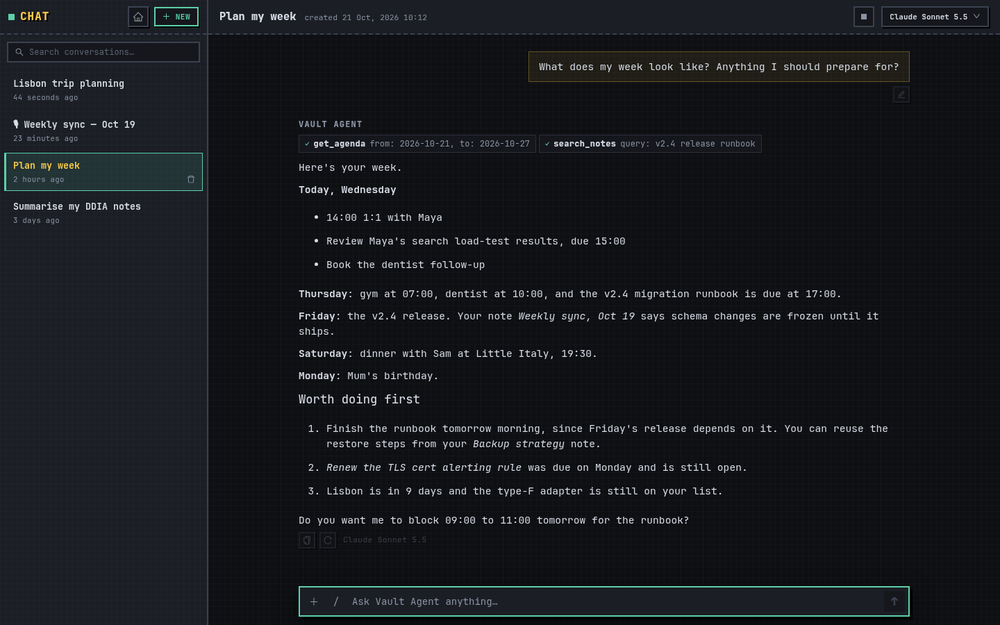
      <p><b>Chat.</b> This is the main way to use the vault. The assistant looks things up in your agenda, notes, tasks, files, recordings and memory, and it can search the web. It answers from what it finds and can make changes for you. Each conversation keeps its history and can use a different model. It works with Anthropic, OpenAI, Gemini, DeepSeek, Minimax or a model running on your own machine.</p>
    </td>
  </tr>
  <tr>
    <td width="50%" valign="top">
      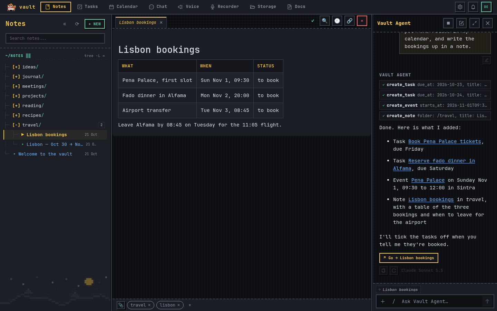
      <p><b>Workspace.</b> You can dock the assistant next to the note you are working on. It reads that note before it answers.</p>
    </td>
    <td width="50%" valign="top">
      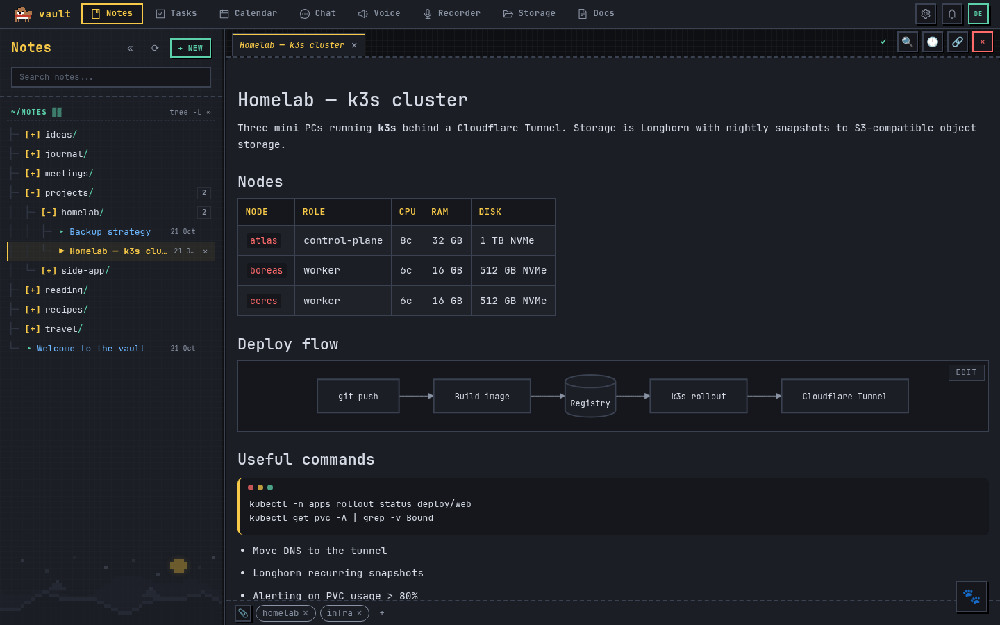
      <p><b>Notes.</b> Markdown notes in folders, with tags and version history. Tables, Mermaid diagrams and code blocks render in place. Any note can be shared at a public link.</p>
    </td>
  </tr>
  <tr>
    <td width="50%" valign="top">
      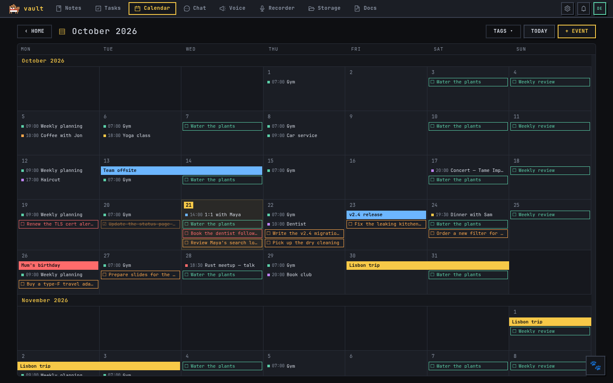
      <p><b>Calendar.</b> A month view that scrolls through the year. An event that lasts several days is one bar across those days. Recurring events and tasks show on every day they happen, and you can tick tasks off from the grid.</p>
    </td>
    <td width="50%" valign="top">
      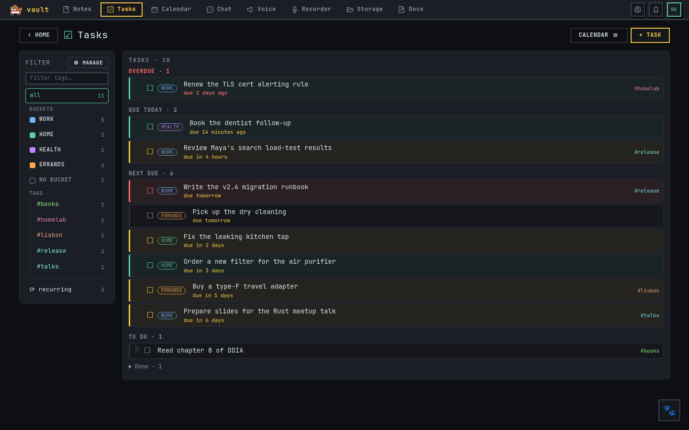
      <p><b>Tasks.</b> Overdue, today and upcoming tasks on one page. Tasks can have a bucket, tags, a priority, a repeat rule and reminders.</p>
    </td>
  </tr>
  <tr>
    <td width="50%" valign="top">
      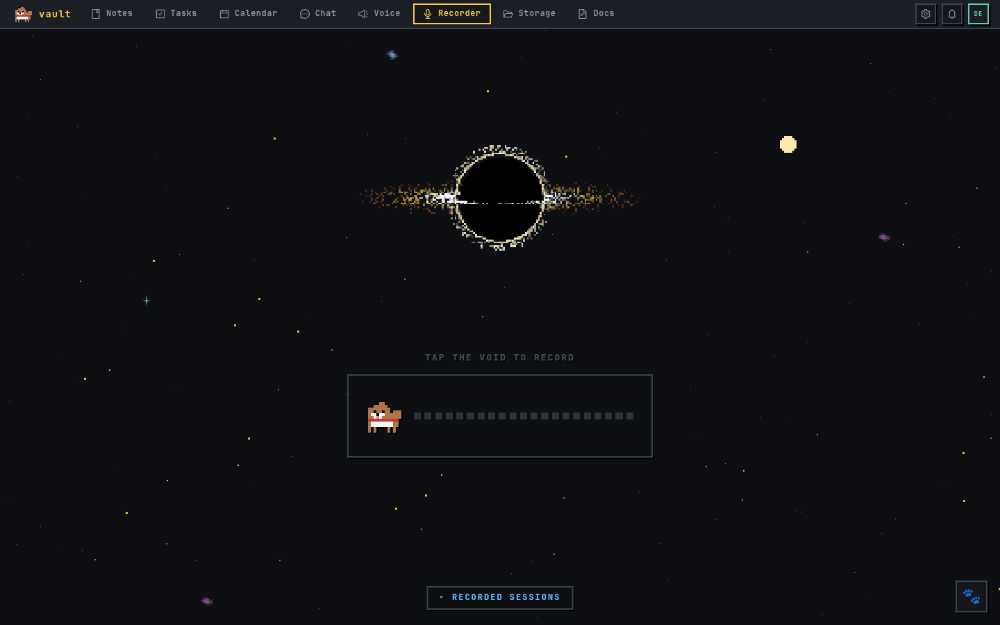
      <p><b>Recorder.</b> Tap the black hole to record a meeting or a voice memo. You see the transcript as you speak, with each speaker labelled.</p>
    </td>
    <td width="50%" valign="top">
      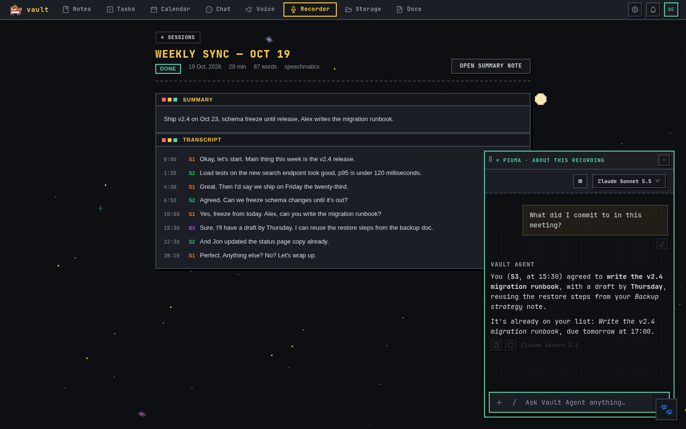
      <p><b>Recordings.</b> Each recording keeps its transcript and gets a summary note. You can ask the assistant questions about one recording.</p>
    </td>
  </tr>
  <tr>
    <td width="50%" valign="top">
      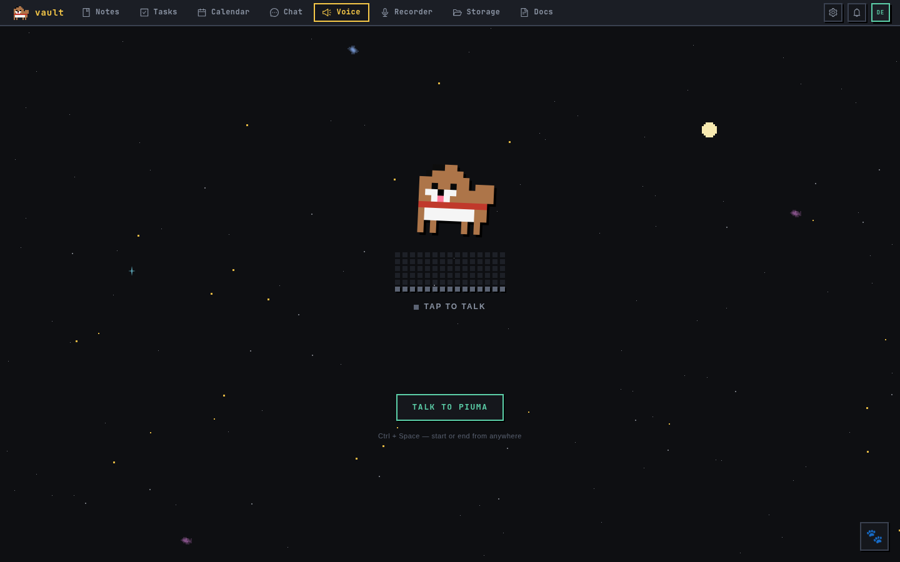
      <p><b>Voice.</b> Talk to the assistant out loud. Press <kbd>Ctrl</kbd> + <kbd>Space</kbd> anywhere in the app to start or stop.</p>
    </td>
    <td width="50%" valign="top">
      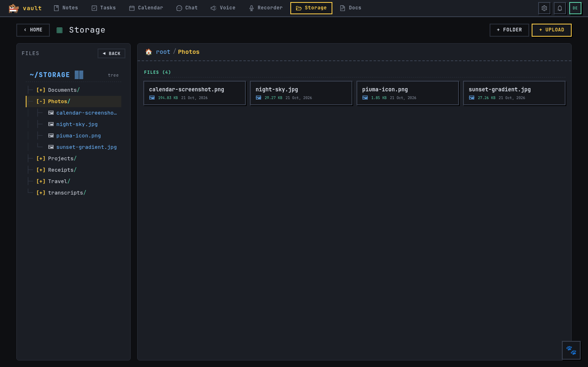
      <p><b>Storage.</b> A file browser on top of your own S3 bucket (Bunny, Cloudflare R2, AWS S3, MinIO and others). You can make folders, upload, preview files and share a folder at a public link.</p>
    </td>
  </tr>
  <tr>
    <td colspan="2" valign="top">
      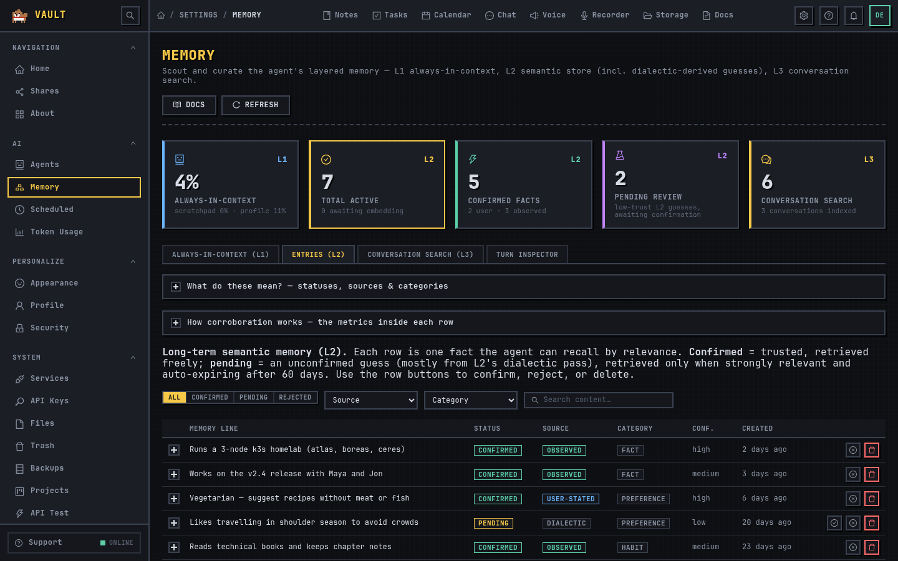
      <p><b>Memory.</b> This page shows what the assistant remembers about you, and you can edit it. There is a short profile it always sees, a list of facts it looks up when they are relevant, and a search over past conversations. Facts it guesses on its own stay marked as pending until you or later conversations confirm them.</p>
    </td>
  </tr>
</table>

<p align="center">
  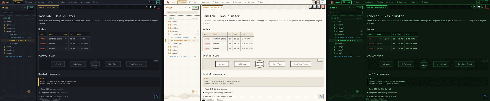
  <br/>
  <sub>Three themes: Mono (dark), Paper (light) and Phosphor (green screen). You switch them for the whole vault on the Appearance page.</sub>
</p>

## Features

### Assistant and memory

You connect the AI providers you want (Anthropic, OpenAI, Gemini, DeepSeek and others) and chat with an assistant that remembers you between conversations. Its memory has three layers.

* L1 is a short profile and scratchpad that goes into every prompt.
* L2 is a list of single facts stored with vector embeddings. The assistant pulls in the ones that match the current conversation. Every few turns it also reads recent chats and writes down facts it thinks are true. Those start as pending and become confirmed when you approve them or when they come up again.
* L3 is full-text search over every past message.

### Notes

* Write in a visual editor (Milkdown) or switch to plain Markdown. Tables, Mermaid diagrams and code blocks render in both.
* Search finds notes by exact words and by meaning (using pgvector).
* Share a single note or a whole folder at a public link with a random address.
* Organise notes with folders and tags.

### Files

* Keep documents, photos and other files in any S3-compatible bucket. Bunny Storage with its CDN is supported directly.
* Browse, upload and preview files from the web app.

### Tasks and calendar

* Calendar events, including multi-day and recurring ones.
* Tasks with due dates, priorities, buckets, tags, repeat rules and reminders.
* The assistant can read both, so you can ask it to plan your day.

### Voice and recorder

* Record meetings and voice memos. Speech is transcribed live with speaker labels, and each recording gets a summary note.
* Ask the assistant about a single recording, and it answers from that transcript.
* Talk to the assistant out loud from anywhere in the app.

### Mobile app

* An Android app built with Expo and React Native. It uses the same API as the web app.
* Notes, tasks, calendar and chat on your phone. Changes show up on your other devices straight away.
* Home screen widgets for your tasks and for a month calendar.
* Task alarms that ring like an alarm clock, with Complete, Snooze and Dismiss buttons, plus push notifications.
* A voice recorder that keeps going in the background and sends the audio to the vault to be transcribed.

<!-- Mobile screenshots go here (docs/screenshots/mobile-*.png). -->

### Security

* You host it, so your data stays on your server and in your bucket.
* Sign in uses JWT tokens signed with RS256. Scripts and other apps can use API keys instead.
* Two-factor sign in with an authenticator app (TOTP).
* Admin pages show system health, database backups and the status of each connected service.

## Architecture

The backend is written in Rust with Actix-web and the frontend is a React app. Nginx serves the frontend and passes API calls to the backend. Background workers handle embeddings, notifications and scheduled agent jobs.

```mermaid
flowchart TD
    CF([Cloudflare <br/> TLS Edge]) -->|HTTPS| Nginx[nginx <br/> Reverse Proxy]

    Nginx -->|Serves Static Assets| FE[frontend <br/> React 19 / Vite 7 SPA]
    Nginx -->|Proxies /api/v1/ to :8080| BE[backend <br/> Rust / Actix-web API]

    BE -->|Raw SQL Queries| DB[(postgres <br/> + pgvector)]

    %% Background workers poll the database for jobs and due alerts
    Worker[embedding-worker <br/> vector queue] -->|Polls embedding jobs| DB
    Worker -.->|Generates 1536-Dim Vectors| AO[Azure OpenAI <br/> text-embedding-3-large]
    NW[notification-worker <br/> Web Push + Expo] -->|Dispatches due alerts| DB
    CW[cron-worker <br/> scheduled agent jobs] -->|Runs RRULE schedules| DB

    classDef store fill:#1b1e25,stroke:#3a4150,stroke-width:2px;
    class DB store;
```

## How memory works

This diagram shows how something said in a chat ends up as a saved fact, and how saved facts get added back into the prompt.

```mermaid
flowchart TD
    Chat([User & Agent Chat]) -->|context_add| L1[(L1 Scratchpad<br/>db_agent_profiles)]

    %% Facts the user states or the agent observes
    Chat -->|Direct User Request| US[User Stated Fact]
    Chat -->|Agent Inference| AO[Agent Observed Fact]

    US -->|memory_save| L2C[(L2 Confirmed Facts<br/>db_memory_entries)]
    AO -->|memory_save| L2C

    %% Every message is logged; a periodic pass guesses new facts
    Chat -->|Passive Write| L3[(L3 Conversation Search<br/>db_chat_messages)]
    L3 -->|Every N Turns| Dialectic[L2 Dialectic Pass]
    Dialectic -->|Multi-Pass Sweep| L2P[(L2 Pending Facts<br/>db_memory_entries)]

    %% Pending facts become confirmed (same table)
    L2P -->|Explicit UI ✓ Click| L2C
    L2P -->|Re-derived + Stage-B NLI entails| L2C
    L2P -->|Opportunistic Ask in Chat| L2C

    %% Facts close enough to the conversation go into the prompt
    L2C -->|Distance < 0.65| Injected([Injected into Next Prompt])
    L2P -->|Distance < 0.5| Injected

    classDef store fill:#1b1e25,stroke:#3a4150,stroke-width:2px;
    classDef action fill:#15171c,stroke:#3a4150,stroke-width:2px;
    class L1,L2C,L3,L2P store;
```

## Tech stack

| Layer | Technologies and libraries |
| :--- | :--- |
| Web frontend | React 19, Vite 7, its own component kit and theme tokens (3 themes), TanStack Query 5, Zustand, Three.js, Milkdown, Mermaid |
| Backend API | Rust, Actix-web 4, SQLx 0.8 (SQL checked at compile time), Tokio, Lettre, Moka cache |
| Database | PostgreSQL 15 with `pgvector` (HNSW indexes) |
| Proxy | Nginx, with Cloudflare in front for TLS |
| Mobile app | Expo / React Native, AsyncStorage, React Navigation, TanStack Query |
| Deployment | Docker Compose with `server-stack` and `db-stack` profiles |

## Quick start (Docker Compose)

You need Docker with Compose v2, and [Bun](https://bun.sh) to build the web frontend.

> Keys for outside services are not set in `.env`. That covers AI providers, Azure OpenAI embeddings, S3 or Bunny storage and SMTP email. You add them after your first sign in, on the Services and Agents pages in Settings. The `.env` file only covers the core stack: compose, server, CORS, database and auth.

### 1. Configure the environment

Copy the template and edit the values:

```bash
cp .env.example .env
```

| Variable | Description |
| :--- | :--- |
| `COMPOSE_PROFILES` | Which profiles start by default: `db-stack` (Postgres) and/or `server-stack` (nginx, backend and workers). |
| `COMPOSE_FILE` | Dev or prod. `docker-compose.yml` is dev (the backend reloads when the code changes). `docker-compose.yml:docker-compose.prod.yml` is prod (compiled release binaries). Compose reads this itself, so a plain `docker compose up -d` starts the right one. |
| `COMPOSE_NAME` | Prefix for container names, also used for nginx's route to the backend. |
| `SERVER_NAME` | Server name used in the nginx config. |
| `BASE_URL` | Path the app is served under. Use `/` unless you host it under a sub-path. |
| `RUST_LOG` | Backend log level (`info`, `debug` and so on). |
| `NGINX_PORT` | Host port nginx listens on. Default `8034`. |
| `CORS_ALLOWED_ORIGINS` | Comma-separated list of exact origins the backend accepts, such as your public URLs. |
| `CORS_ALLOW_LOCAL` | If `true`, also accept `localhost` and LAN origins, which helps in development. Set it to `false` in production. |
| `DB_HOST` | Postgres host. Use `db` for the compose database service. |
| `DB_USER` / `DB_PASSWORD` / `DB_NAME` | Postgres user, password and database name. |
| `DB_PORT` | Postgres port inside the Docker network (`5432`). |
| `DB_PORT_EXTERNAL` | Host port mapped to Postgres, so you can connect with `psql` from your machine. |
| `DB_VERIFY_SCHEMA` | At startup, check the database tables against the definitions in `db_init`. `1` is on, `0` is off. |
| `SITE_URL` | The public URL of the site. Authenticator apps also show it as the name of the account. |

> The JWT and Web Push (VAPID) keys are generated into `rust/src/keys/` on the first build. You don't need to set them.

### 2. Build the web frontend

Nginx serves the built app from `frontend/dist`, so build it once, and again after each frontend change:

```bash
cd frontend && bun install && bun run build && cd ..
```

### 3. Start the stack

```bash
docker compose up -d
```

`COMPOSE_FILE` in your `.env` decides which stack this starts.

* Dev is the template default. The backend runs under `cargo watch`, so the first start compiles the Rust code and takes a few minutes. After that it reloads when you change the code. Watch it with `docker compose logs -f rust`.
* Prod uses `docker-compose.prod.yml` on top of the base file to run compiled release binaries. Nothing reloads on its own. After a backend change, run `docker compose up -d --build`, or `docker compose up -d --build rust` for the API only. Frontend changes only need step 2, because nginx serves `frontend/dist` straight from disk.

The vault is then at `http://localhost:8034`, or on whatever `NGINX_PORT` you set.

### 4. Create your account

The vault has one account and no sign-up page. Open the app. On a fresh install it shows a setup form instead of the sign-in form. The email and password you enter become the admin account, and you are signed in straight away.

After that the setup form never appears again, and you sign in normally. The password must be at least 10 characters and use at least three of these: lowercase letters, uppercase letters, digits and symbols.

Then open the Services and Agents pages in Settings to add your AI, embedding, storage and email providers.

## Development and documentation

This README keeps to the basics. The rest is in the app itself.

* Your running vault has more documentation at `/docs`: getting started, architecture, each feature, the mobile app, and operations and deployment.
* For local development, run the frontend dev server with `cd frontend && bun run dev`. It sends `/api` requests through nginx. Follow the backend with `docker compose logs -f rust`.
* The mobile app is kept in a separate repository and is not included here. It uses the same API as the web app, so you can also build your own client.

## License

Copyright (C) 2026 Piuma Vault contributors.

Piuma Vault is free software under the GNU Affero General Public License v3.0 (AGPL-3.0). You can use, change and share it under that license. If you run a changed version as a network service, you must make your changed source code available to its users. See the [LICENSE](LICENSE) file for the full text.
